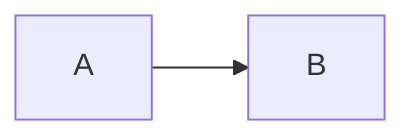

# ChatGPT Conversation Export

<p align="center">
  <a href="./README.md"></a>
  <a href="./README.en.md"></a>
  <a href="./LICENSE"></a>
</p>

ChatGPT Conversation Export is a **Chrome and Microsoft Edge** extension that exports complete ChatGPT conversations as Markdown or JSON. It uses Chromium's built-in `chrome.debugger` API to read conversation data in the current ChatGPT tab.

The extension avoids relying on virtualized DOM content or page scrolling. Long conversations can be exported with complete user messages, assistant responses, fenced code blocks, Mermaid source, and LaTeX formulas even when only part of the conversation is rendered on screen.

> Export temporarily attaches the Chromium debugger and detaches it when finished. The extension reads the conversation API in the current page first, then reloads and captures network responses only if that fails.


## ✨ Features

- Export complete ChatGPT conversations, including older paginated messages, without scrolling the page.
- Export as Markdown or JSON.
- Name files as `conversation-title-YYMM.md` or `conversation-title-YYMM.json`.
- Preserve original assistant Markdown.
- Preserve fenced code blocks, Mermaid source, and LaTeX formulas.
- Search rendered messages with highlighting and previous/next navigation.
- Start minimized as a draggable `GPT` button in the bottom-right corner.
- Follow ChatGPT light and dark themes.
- Support Google Chrome and Microsoft Edge.

<p align="center">
  
</p>

## 🧩 Supported Environment

- Chromium Manifest V3
- Google Chrome
- Microsoft Edge
- `https://chatgpt.com/*`
- `https://chat.openai.com/*`

The full-export implementation requires Chromium's `chrome.debugger` API and does not support Firefox.

## 📦 Installation

### Chrome

1. Open `chrome://extensions/`.
2. Enable Developer mode.
3. Click **Load unpacked**.
4. Select this project directory.
5. Approve the requested permissions.


<p align="center">
  
</p>

### Microsoft Edge

1. Open `edge://extensions/`.
2. Enable Developer mode.
3. Click **Load unpacked**.
4. Select this project directory.
5. Approve the requested permissions.

Chrome and Edge are both Chromium-based, so they use the same installation steps and full-export mechanism.

## 🔐 Browser Permissions and Invocation

The extension requests the following elevated permissions:

- `debugger`: temporarily read the current ChatGPT tab's own conversation network response.
- `downloads`: download generated Markdown or JSON files.
- `tabs`: report export results after the conversation reloads.

These permissions are not continuously invoked after browser startup. The background service worker runs this sequence only when the user clicks `Export`:

```text
Click Export
  -> chrome.runtime.sendMessage notifies the background service worker
  -> chrome.debugger.attach temporarily attaches to the current ChatGPT tab
  -> read the conversation API and older pages in the current tab
  -> reload and capture the network response if needed
  -> chrome.downloads.download saves the generated file
  -> chrome.debugger.detach disconnects automatically
```

The extension does not read network responses from other tabs and does not keep the debugger attached continuously. It attempts to detach after success, failure, or timeout. Chromium may display a debugger-attached notice during export; this is the browser's normal security notice for the `chrome.debugger` API.

## 🚀 Usage

1. Open the ChatGPT conversation to export.
2. Click the bottom-right `GPT` button to expand the toolkit.
3. Select `Markdown` or `JSON`.
4. Click `Export`.
5. The generated file downloads automatically. The conversation reloads once only if the direct API read fails.

Export does not scroll the page. Use it on a specific conversation whose address contains `/c/`.

## 📝 Output Filename

Exported files use:

```text
conversation-title-YYMM.md
conversation-title-YYMM.json
```

For example, a conversation titled `python` exported in June 2026 becomes `python-2606.md`.

The extension first uses `conversation.title` from the complete conversation response, then falls back to the current ChatGPT page title. Invalid Windows filename characters are replaced automatically.

## 📄 Exported Content

### Markdown

Messages are written in conversation order:

```markdown
# ChatGPT Conversation

- Exported: 2026-06-04T00:00:00.000Z
- Source: https://chatgpt.com/c/...
- Messages: 126

## 1. User

User message

## 2. Assistant

Assistant response
```

Original Mermaid and LaTeX source is preserved:

````markdown


Inline formula: $E = mc^2$

Display formula:

$$
E = mc^2
$$
````

### JSON

JSON exports include metadata and the complete message array:

```json
{
  "exportedAt": "2026-06-04T00:00:00.000Z",
  "url": "https://chatgpt.com/c/...",
  "exportSource": "chromium-debugger-network",
  "messageCount": 126,
  "messages": [
    {
      "index": 1,
      "role": "user",
      "text": "..."
    }
  ]
}
```

## 🔎 Search

- Search text in currently rendered messages.
- Highlight matching text.
- Navigate with `Prev` and `Next`.

Search covers currently rendered page content. Full export does not have this limitation.

## ⚙️ How It Works

```text
User clicks Export
  -> background service worker attaches chrome.debugger
  -> extension reads the current conversation and all older pages
  -> reloads and captures the network response if needed
  -> current User / Assistant / System branch is ordered
  -> Markdown or JSON is generated
  -> file downloads and debugger detaches automatically
```

## ⚠️ Known Limitations

- ChatGPT private response format changes may require parser updates.
- Export is available on conversation pages; the home page prompts you to open a conversation.
- The browser displays a debugger-attached notice during export.
- Export may fail if another debugger or DevTools session is already attached to the tab.
- Export follows the currently selected conversation branch rather than every historical branch.
- Search covers only currently rendered messages.
- Full export does not support Firefox.

## 🗂️ Project Structure

```text
background.js          Chromium debugger capture and file download
contentScript.js       Page initialization and result messages
core/                  Shared state and English UI strings
features/export.js     Export entry point and legacy DOM fallback tools
features/search.js     Rendered-message search
ui/                    Toolbar, floating button, and theme sync
utils/                 DOM, content extraction, and lightweight state tools
image/                 Extension icons
manifest.json          Manifest V3 configuration
styles.css             Toolbar and search styles
```

## 📌 Version

### Current version: v2.0.4

- Support both legacy `mapping` and current paginated `messages` conversation formats.
- Read the browser conversation API first, with debugger network capture as a fallback.
- Show an error on non-conversation pages and display the export result.
- Wait for Chrome to confirm download completion and report interruptions.
- Markdown and JSON export.
- Conversation-title filenames.
- Chrome and Microsoft Edge support.
- Original Mermaid, LaTeX, and fenced code block preservation.
- Rendered-message search.

## 📜 License

This project is licensed under the [MIT License](./LICENSE).
